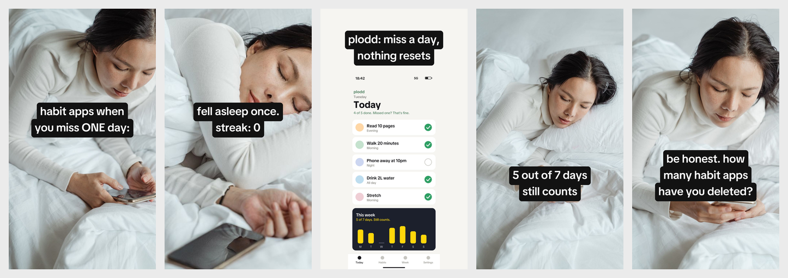

# TikTok Slideshow Skill for Claude Code, OpenClaw, Codex and Cursor

**TikTok Slideshow Skill** is a free, open-source AI agent skill that makes TikTok photo-mode
slideshows for your app. Claude Code, Claude, OpenClaw, Codex, Cursor and other agents use it to
write hooks in batches, render native-looking 1080x1920 slides on real photos with a local Python
renderer, and post them to one or many TikTok accounts (plus Instagram as a carousel) once you
approve. A hook log keeps each post's views next to the downloads you report, so the next batch
builds on what worked. No image API key, no credits, no subscription. MIT licensed.

```bash
npx skills add social-media-skills/tiktok-slideshow-skill -g -a claude-code -y
```



*Example output for a made-up habit app ("plodd"). Photos: one Pexels shoot, so it reads
like one person's camera roll.*

## Contents

- [What the TikTok slideshow skill does](#what-the-tiktok-slideshow-skill-does)
- [Install](#install)
- [Example: Claude Code makes TikTok slideshows](#example-claude-code-makes-tiktok-slideshows)
- [The slide renderer](#the-slide-renderer-a-tiktok-slideshow-generator-that-runs-on-your-machine)
- [TikTok slideshow formats for app marketing](#tiktok-slideshow-formats-for-app-marketing)
- [Posting to one or many TikTok accounts](#posting-tiktok-slideshows-to-one-or-many-accounts)
- [Works with](#works-with)
- [FAQ](#faq)

## What the TikTok slideshow skill does

Tell your agent "make TikTok slideshows for my app" and it runs the whole workflow:

1. **Learns your app.** It reads your notes or asks what the app does, who it's for, which real
   stories you can share, what screenshots and photos you have, and how old each account is.
2. **Writes 10 to 20 hooks** about the viewer, never about the app, and picks the best few.
3. **Writes 5 to 6 slides** per slideshow with the app on slide 2 or 3, named and shown as a
   full-screen screenshot, then the caption and hashtags.
4. **Renders slides that look native:** one photo shoot per slideshow, TikTok Sans with TikTok's
   own text styles, one text block per slide, text kept clear of faces and of TikTok's buttons and
   caption. 4:5 copies for Instagram and contact sheets to review.
5. **Posts after you say yes**, as native TikTok photo posts: a draft in your TikTok inbox (the
   default, so you add a sound) or straight to your feed. A batch is confirmed once.
6. **Tracks what converts.** After 2 or 3 days it reads the posts' metrics back, asks for your
   daily downloads, and tells you what to scale, fix or retire.

Every slideshow passes an honesty check first: no invented user numbers, reviews or results, no
first-person stories you didn't give it, real screenshots, and AI images disclosed on TikTok.

## Install

**Claude Code**

```bash
npx skills add social-media-skills/tiktok-slideshow-skill -g -a claude-code -y
```

**Codex, Cursor, OpenClaw and other agents:** run
`npx skills add social-media-skills/tiktok-slideshow-skill` and pick your agent, or copy
`skills/tiktok-slideshow-skill/` into your agent's skills directory.

**GitHub CLI:** `gh skill install social-media-skills/tiktok-slideshow-skill tiktok-slideshow-skill`

**Gemini CLI:** `gemini extensions install https://github.com/social-media-skills/tiktok-slideshow-skill`

**OpenClaw (ClawHub):** `openclaw skills install @social-media-skills/tiktok-slideshow-skill`

**Claude (claude.ai):** download `tiktok-slideshow-skill.zip` from the
[latest release](https://github.com/social-media-skills/tiktok-slideshow-skill/releases/latest)
and upload it under Customize > Skills.

Rendering needs Python 3.8+ and Pillow (`pip install pillow`).

## Example: Claude Code makes TikTok slideshows

```
You: Make TikTok slideshows for my app, a habit tracker without streaks.
     Screenshots are in ./screens. No photos.

Agent: 15 hooks written. Best 3 for this batch:
       1. "habit apps when you miss ONE day:"
       2. "your streak on day 46 vs day 47"
       3. "be honest. how many habit apps have you deleted?"
       I found one Pexels shoot (one person, one bedroom) for the photos.
       Here are 3 slideshows, 5 slides each, app on slide 3. Render them?

You: Yes.

Agent: Rendered. Contact sheets in slideshow-1/ to slideshow-3/.
       Ready to send as TikTok inbox drafts to @habits_without_guilt,
       Tue, Wed, Thu at 18:00. Post them?
```

## The slide renderer: a TikTok slideshow generator that runs on your machine

`scripts/render_slides.py` turns a small JSON spec into slides. It needs Python and Pillow only.

```json
{
  "theme": {"style": "highlight", "strip": "black"},
  "slides": [
    {"text": "habit apps when you miss ONE day:", "image": "photos/bed-phone.jpg"},
    {"text": "fell asleep once.\nstreak: 0", "image": "photos/bed-asleep.jpg", "position": "center"},
    {"text": "plodd: miss a day,\nnothing resets", "image": "screens/plodd-today.png", "layout": "fullscreen"}
  ]
}
```

```bash
python3 scripts/render_slides.py slides.json --out slideshow/
```

What you get:

- 1080x1920 JPEGs with text kept clear of TikTok's buttons and caption area.
- TikTok Sans, the open-source font TikTok uses, bundled in `fonts/`.
- TikTok's text looks: `highlight` (text on merged strips, white or black) and `classic` (white
  with a thin outline and a soft shadow), set once per slideshow.
- A `fullscreen` layout for real app screenshots, and text placement per slide (`upper`, `top`,
  `center`, `bottom`) to keep it off faces.
- 4:5 copies for an Instagram carousel (skip with `--no-instagram`), contact sheets, and warnings
  when text is too long or styles are mixed.

Photos can be your own, free stock photos (Pexels or Unsplash license; the skill looks for one
shoot so the slideshow reads as one person's camera roll), or an image model your agent already
has.

## TikTok slideshow formats for app marketing

| Format | Slide 1 example | Needs your own story? |
|---|---|---|
| Relatable scenario | "habit apps when you miss ONE day:" | No (the default) |
| Someone else, conflict, reveal | "my sister said I'd quit by day 9" | Yes |
| Tension then release | "studying at 2am the night before finals" | No |
| Honest test | "I tried 4 habit tracker apps for 30 days" | Yes |
| Mistake list | "3 mistakes I made with my first budget" | Yes |
| Tiny tutorial | "how to plan a week in 4 minutes" | No |

The slides follow the SLIDE structure: **S**top (a hook about the viewer), **L**ead in (make the
problem felt), **I**ntroduce (the app on slide 2 or 3, shown for real), **D**eliver (what
changes), **E**nd (one question). Details in `references/slide-framework.md`.

## Posting TikTok slideshows to one or many accounts

Posting goes through the [WoopSocial](https://woopsocial.com/?utm_source=tiktok-slideshow-skill&utm_medium=readme)
MCP. WoopSocial has a free plan for 2 social accounts with MCP access and no card. Your agent
connects it in about two minutes, and nothing posts until you approve the exact slides, caption
and settings. Disclosure: this skill is maintained by the team behind WoopSocial. If you'd rather
not connect anything, the skill hands you the finished images and caption to post yourself.
Setup steps for every agent: [woopsocial.com/agents](https://woopsocial.com/agents?utm_source=tiktok-slideshow-skill&utm_medium=readme).

Running several TikTok accounts for one app (different niches, languages or angles) is a common
setup. The skill gives each account its own hooks, staggers posting times, warms up new accounts
before their first post, and shows each batch as one table for you to approve. It never posts the
identical slideshow to several accounts.

## Works with

| Agent | Renders slides | Posts |
|---|---|---|
| Claude Code, OpenClaw, Codex, Cursor | Locally with Python | Yes, through the WoopSocial MCP |
| Claude (claude.ai, Desktop) | In the code sandbox | Yes, through the WoopSocial connector |
| Chat AI without code tools | Writes the slide plan for TikTok's editor or CapCut | You post it yourself |

## FAQ

**What is the TikTok slideshow skill?**
A free, MIT-licensed agent skill (a `SKILL.md` plus scripts) that writes, renders and posts TikTok
photo-mode slideshows for app marketing. It works in Claude Code, Claude, OpenClaw, Codex, Cursor
and other agents that support skills.

**Can Claude make TikTok slideshows?**
Yes. With this skill, Claude or Claude Code writes the hooks and slides, renders them as 1080x1920
images and can post them to TikTok as native photo posts after you approve.

**How do I automate TikTok slideshows with OpenClaw?**
Install the skill from ClawHub (`openclaw skills install @social-media-skills/tiktok-slideshow-skill`),
connect WoopSocial, and ask your agent for a batch. It confirms each batch before posting, and
inbox drafts are the default so you add the sound in TikTok.

**Which agents does it work with?**
Claude Code, Claude (claude.ai), OpenClaw, Codex and Cursor. It ships its own local slide renderer
with TikTok's font, so no image API key is needed, and it plans a different variant for each
account when you run several.

**Is there an open-source TikTok slideshow generator on GitHub?**
This repo is one: `scripts/render_slides.py` is a standalone, MIT-licensed renderer you can use
without an agent. Give it a JSON spec and photos and it writes the slides.

**Can it make Instagram carousels too?**
Yes. Every render also writes 4:5 copies, and the skill can post them as a separate Instagram
carousel. Instagram carousels take at most 10 slides.

**Does it post the slideshow as a video or as photos?**
As a native TikTok photo post (photo mode), which gets the swipe interface. By default it lands
as a draft in your TikTok inbox so you can add a sound and publish.

**How often should I post TikTok slideshows?**
Operators who report results post 1 to 3 per account per day once an account is warmed up. New
accounts first get 7 to 14 days of normal use. The skill batches the work so you confirm a week
of slideshows at once.

**Do AI-generated slides need a label on TikTok?**
TikTok asks for realistic AI content to be disclosed. With an inbox draft you switch on TikTok's
AI label before publishing. For direct posts the skill puts the disclosure in the caption.

**Will this get my slideshows views?**
Nobody can promise that. The skill makes hooks testable and logs views next to the downloads you report,
so you learn what works for your app faster. It never invents numbers.

**Is it free?**
The skill is MIT-licensed and free. Posting through WoopSocial is free for 2 social accounts;
more accounts need a paid plan.

## What's inside

All of it lives in [`skills/tiktok-slideshow-skill/`](skills/tiktok-slideshow-skill/):

| File | What it does |
|---|---|
| `SKILL.md` | The workflow the agent follows |
| `scripts/render_slides.py` | Renders TikTok and Instagram slides from a JSON spec |
| `scripts/upload_parts.py` | Uploads a slide to a WoopSocial upload session |
| `references/` | The SLIDE framework, app-marketing formats, warm-up and multi-account testing, 2026 TikTok rules, posting guide |
| `fonts/` | TikTok Sans (SIL Open Font License) |
| `examples/` | A full example slideshow: spec, photos (Pexels License) and rendered slides |
| `evals/evals.json` | Test scenarios for the skill |

## More free social media skills

More skills for social media work: [social-media-skills.com](https://social-media-skills.com)

Maintained by Frank Heijdenrijk and the team behind WoopSocial.

## License

MIT. TikTok Sans is under the SIL Open Font License (`skills/tiktok-slideshow-skill/fonts/OFL.txt`).
